<div align="center">


# Au Temps Donné

### A full-stack platform for a food-aid association

One REST API and three clients run the association's whole food-rescue chain, from a supermarket's unsold stock to a delivery route, along with volunteers, beneficiaries, events and support tickets.

[](https://flask.palletsprojects.com)
[](https://react.dev)
[](https://tailwindcss.com)
[](https://www.mysql.com)
[](#-volunteers-in-the-field)
[](#-the-help-desk)
[](#-shipping-it)
[](#-shipping-it)

[Tour](#-a-quick-tour) · [The demand](#-it-starts-at-the-supermarket) · [The route](#-planning-the-pickup) · [The scan](#-scan-and-its-in-stock) · [The people](#-volunteers-beneficiaries-and-events) · [The field](#-volunteers-in-the-field) · [The desk](#-the-help-desk) · [Under the hood](#-under-the-hood) · [Shipping](#-shipping-it) · [Quick start](#-try-it-yourself) · [Team](#-team)

</div>

---

## One association, four kinds of users

*Au Temps Donné* is a (fictional) humanitarian association. It collects unsold food from partner supermarkets, stores it in warehouses, and redistributes it during street rounds. It also runs activities, courses and services for the people it helps.

That means four kinds of users with very different needs:

| Role | What they do on the platform |
|---|---|
| **Admin** | Validates accounts, manages stock, shops and vehicles, plans collects and deliveries, and handles support tickets |
| **Merchant** | Offers unsold food and prints a QR label for the pickup |
| **Volunteer** | Joins collects, deliveries and events, checks their planning, and uses the Android app in the field |
| **Beneficiary** | Browses and signs up for activities, courses and services |

We built **Au Temps Donné** as our annual school project: three developers, three and a half months (February to May 2024), **419 commits and 78 merged pull requests**. It was deployed to production at `au-temps-donne.fr` through a CI/CD pipeline.

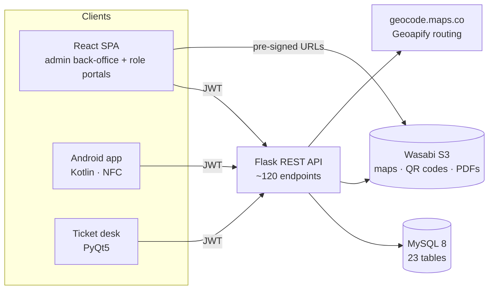

---

## 🎬 A quick tour

<p align="center">
  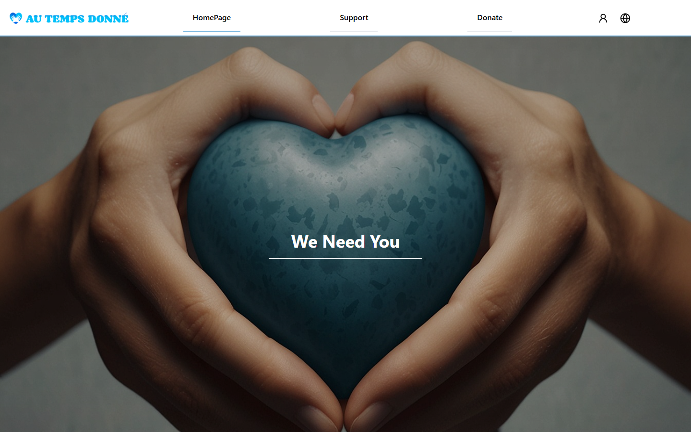
  <br /><sub><em>The public home page</em></sub>
</p>

<p align="center">
  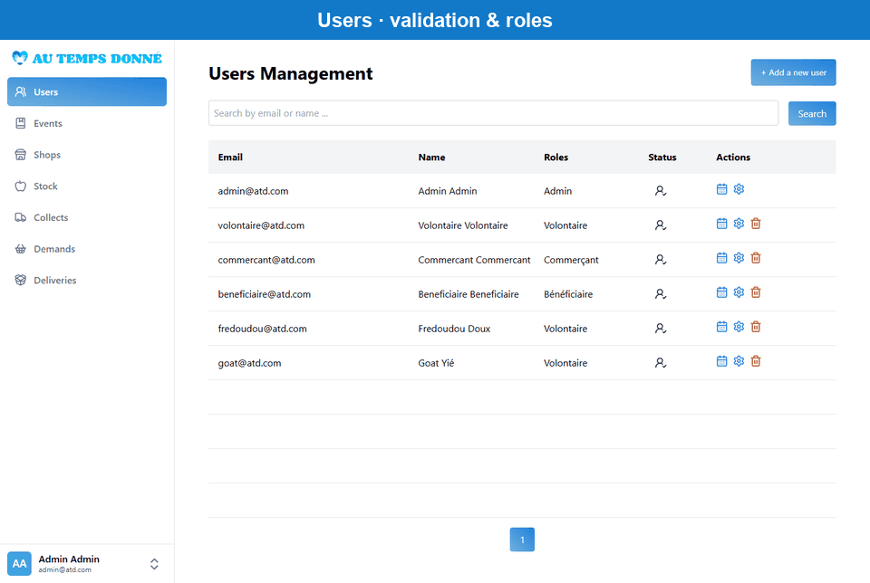
  <br /><sub><em>The admin back-office: users, events, stock, shops, demands, collects and deliveries</em></sub>
</p>

---

## 🏪 It starts at the supermarket

A partner shop has a crate of yogurts expiring on Friday. The merchant logs in, opens **Demand to Collect**, lists the packages (food, weight, expiry date) and sets a deadline.

The API then creates two things for the demand:

- **A QR code** that encodes a receipt URL with the package list and the demand ID.
- **A printable PDF label** with the QR code, the shop's name and address, and the package list.

Both files go to **Wasabi S3** object storage. The merchant prints the label and sticks it on the crate.

<table width="100%">
  <tr>
    <td width="50%">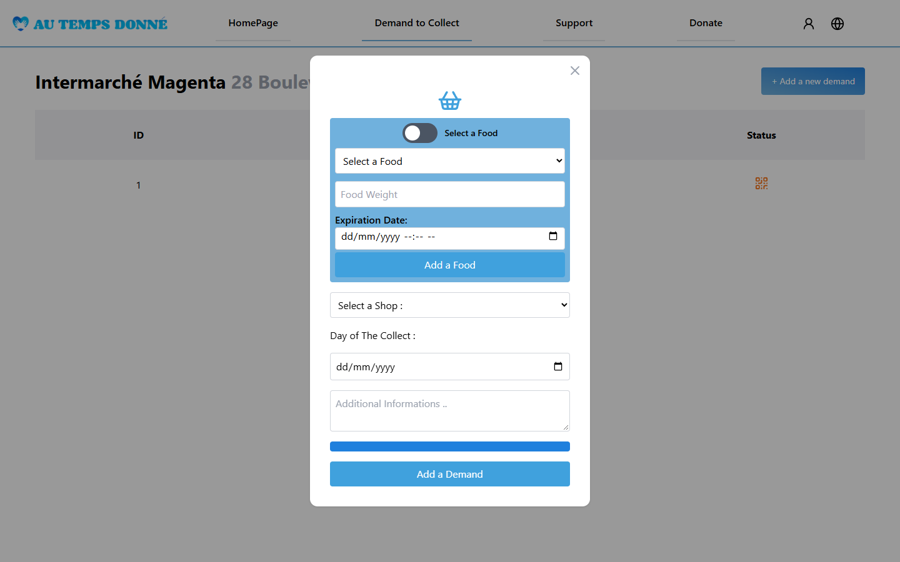</td>
    <td width="50%">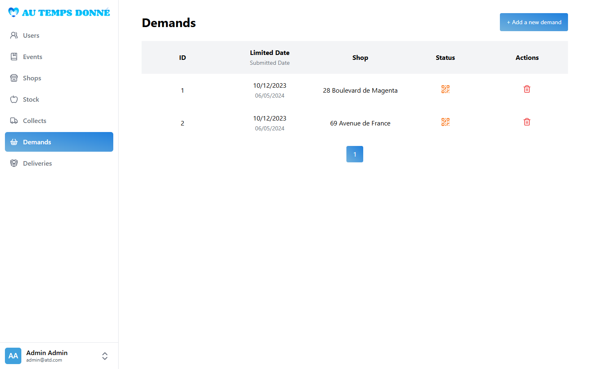</td>
  </tr>
  <tr>
    <td align="center"><sub><em>The merchant lists the food to pick up</em></sub></td>
    <td align="center"><sub><em>The demands in the back-office, each with its QR label</em></sub></td>
  </tr>
</table>

---

## 🗺 Planning the pickup

Next, an admin creates a **collect**. They choose a vehicle, a destination storage in one of the warehouses, and the open demands to pick up. The API then plans the route automatically ([`api/src/service/roadmap.py`](api/src/service/roadmap.py)):

1. **Geocoding.** Every address is geocoded to latitude and longitude when it is created (geocode.maps.co).
2. **Ordering the stops.** We wrote our own **Travelling Salesman heuristic**, starting and ending at the warehouse:
   - It builds a **nearest-neighbour** tour from a `scipy` distance matrix.
   - It improves the tour with a **randomized 2-opt-style segment reversal**: it reverses a random slice, keeps the change if the loop gets shorter, and stops after *n²* failed attempts in a row.
   - It runs this **5 times** and keeps the best tour.
3. **Real roads.** The ordered stops go to the **Geoapify Routing API**, which returns the driving polyline, the total distance and the travel time.
4. **Rendering.** **Folium** (Leaflet) draws an interactive map with the warehouse flag, the stops and the route. Headless Chrome turns the map into a PNG, and **FPDF** builds a printable roadmap with the map, the estimated time, the distance and the ordered stop list.
5. **Storage.** The HTML map and the PDF go to S3 and are attached to the collect.

In the back-office, the roadmap opens in a modal: the live Folium map in an iframe, plus a button to download the PDF. The front end gets these files through **5-minute pre-signed S3 URLs**. It also rewrites the stored map's `Content-Type` on the fly so the HTML renders inline instead of downloading.

**Deliveries** work the same way in the other direction: a vehicle, a set of packages from stock, a list of drop-off locations and an optimized roadmap.

<p align="center">
  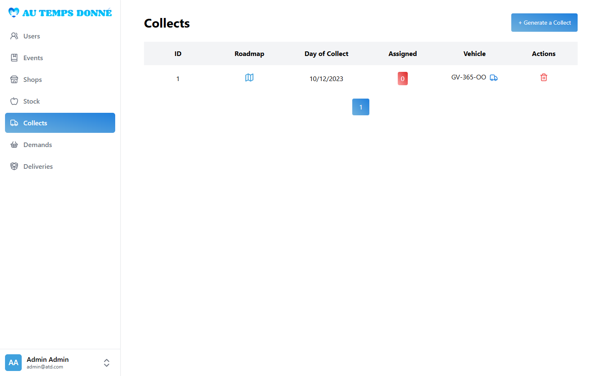
  <br /><sub><em>Collects: each one has a date, a vehicle, its assigned volunteers and its roadmap (map icon)</em></sub>
</p>

---

## 📦 Scan, and it's in stock

At the shop, the volunteer scans the QR code on the label. It opens a **receipt page** ([`web/src/pages/ReceiptQR.jsx`](web/src/pages/ReceiptQR.jsx)) showing the demand, the assigned collect, the vehicle and the destination storage.

One click on **Submit the packages** adds every package into that warehouse storage and closes the demand. Nobody has to retype anything.

<table width="100%">
  <tr>
    <td width="50%">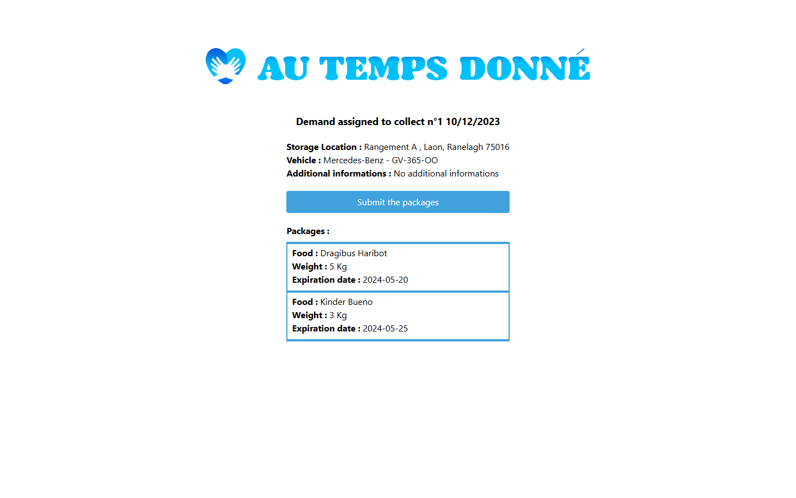</td>
    <td width="50%">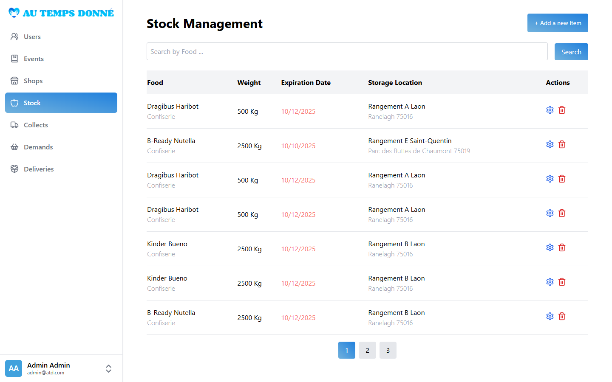</td>
  </tr>
  <tr>
    <td align="center"><sub><em>What the volunteer sees after scanning the label</em></sub></td>
    <td align="center"><sub><em>The packages land in the warehouse stock</em></sub></td>
  </tr>
</table>

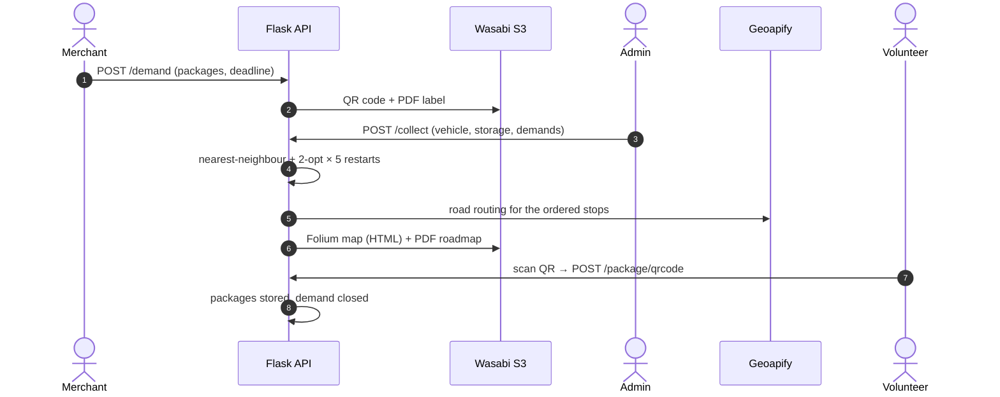

---

## 🙋 Volunteers, beneficiaries and events

Besides logistics, the association runs **events** in three groups: **activities**, **courses** and **services**. Each event has a type, a capacity, a place and a list of participants.

- **Beneficiaries** browse activities and sign up for them.
- **Volunteers** join services, collects and deliveries, and see everything in a single **planning** view, including the roadmap of each tour.
- **Admins** run everything from a back-office with **seven sections**: users (with an account-validation queue and roles), events (with participant lists), stock, shops (and linking merchants to their shop), collects, demands and deliveries. Every table is paginated and searchable.

New accounts start as *pending* and can't log in until an admin validates them.

<table width="100%">
  <tr>
    <td width="50%">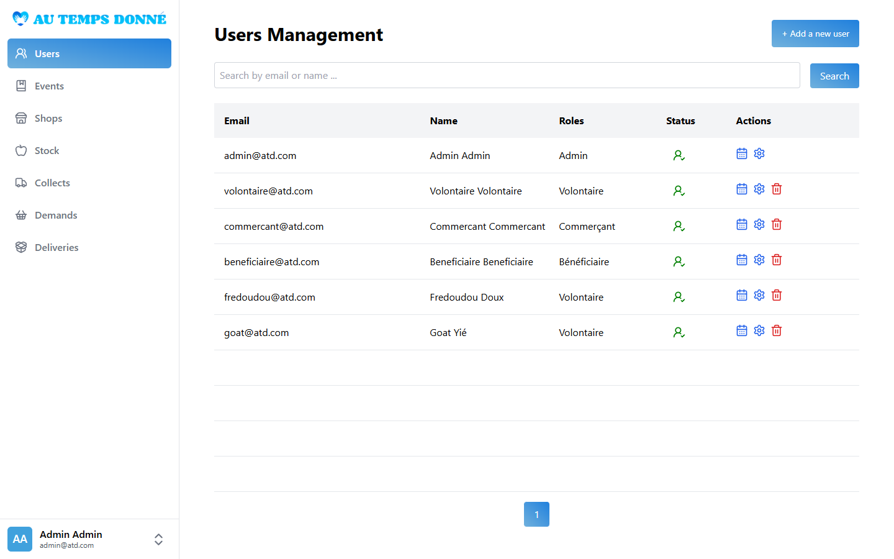</td>
    <td width="50%">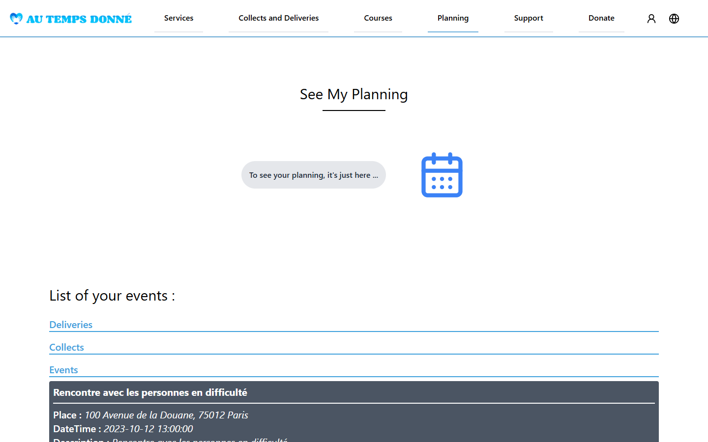</td>
  </tr>
  <tr>
    <td align="center"><sub><em>Users, with their roles and validation status</em></sub></td>
    <td align="center"><sub><em>A volunteer's planning: events, collects and deliveries</em></sub></td>
  </tr>
</table>

### 🌍 Four languages

The entire web app is translated into **French, English, Spanish and Chinese** (about 312 keys per language) with `react-intl`. A flag switcher in the navbar, sidebar and footer changes the language.

<p align="center">
  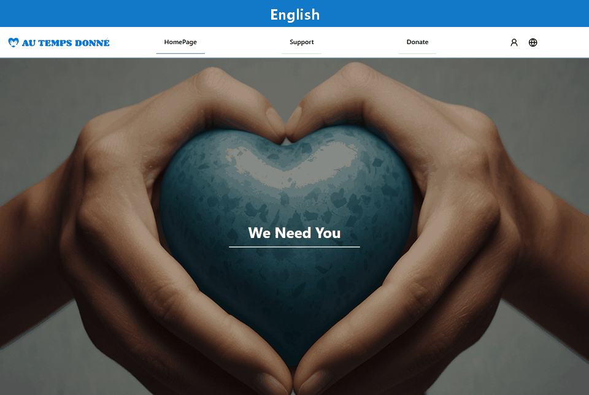
</p>

---

## 📱 Volunteers in the field

The **Android app** ([`mobile-app/`](mobile-app/)) is written in Kotlin with Volley and is for volunteers only: other roles are rejected at login.

On the app, volunteers can:

- see their upcoming events and the details of each one;
- check their profile;
- **scan a beneficiary's NFC card** at an event. The app reads the NDEF payload with `NfcAdapter` reader mode and identifies the beneficiary. A separate developer screen writes the beneficiary ID to blank tags.

The NFC check-in is a working proof of concept. Saving each check-in to the API was the next step.

---

## 🎫 The help desk

Any logged-in user can open a support ticket from the website. The ticket has one of 7 request types: account recovery, technical issue, billing, feature request, and so on.

<p align="center">
  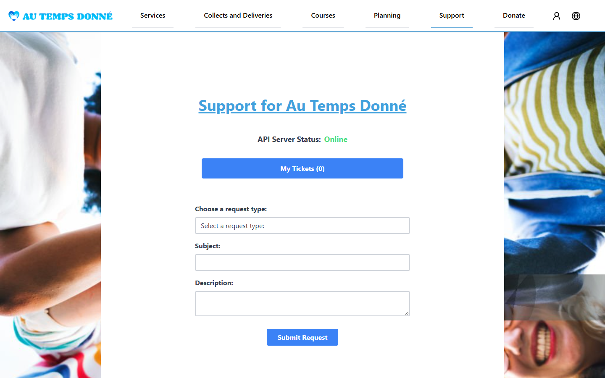
  <br /><sub><em>The support page: live API status, the ticket form and the user's own tickets</em></sub>
</p>

Admins handle tickets in a dedicated **desktop app** ([`ticket-app/`](ticket-app/)) built with **PyQt5**:

- **Dashboard**: six counters (total, active and closed tickets, for everyone and for me).
- **Tickets**: every ticket, with details and an *Assign to me* button.
- **My tickets**: unassign a ticket, or move it between *New*, *In Progress* and *Closed*.

Tokens are stored in the **OS credential vault** through `keyring` instead of a plain file. The app is styled with a Qt stylesheet and can be packaged with PyInstaller.

<p align="center">
  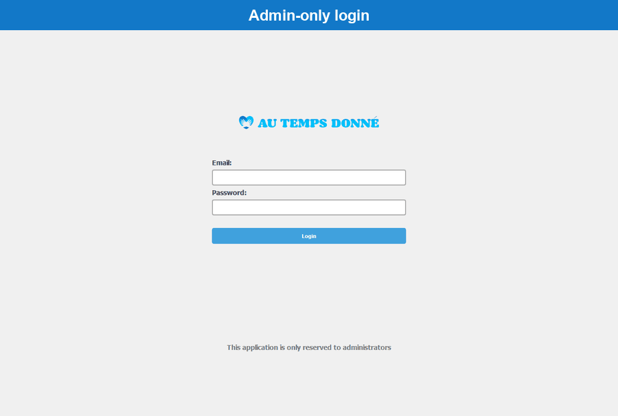
</p>

---

## 🛠 Under the hood

| Layer | Choice | Why |
|---|---|---|
| **API** | Flask 3 + Flask-RESTful + SQLAlchemy 2 | A small framework with an explicit structure that we organized ourselves. |
| **Auth** | Flask-JWT-Extended: 1 h access tokens, 30-day refresh tokens, roles as a JWT claim | One auth scheme shared by the web, Android and desktop clients. |
| **Passwords** | passlib `sha256_crypt` (salted, 5,000 rounds) + strong-password regex | Never store plain text. |
| **Database** | MySQL 8 with 23 tables and 29 foreign keys | Relational data: users ↔ roles ↔ events, shops ↔ demands ↔ collects, warehouses ↔ storages ↔ packages. |
| **Web** | React 18 + React Router 6 + Tailwind 3, bundled with webpack 5 and Babel | No framework magic: a hand-made webpack config. |
| **i18n** | react-intl, 4 languages | French, English, Spanish, Chinese. |
| **Files** | Wasabi (S3-compatible) through boto3 and aws-sdk | QR codes, PDF labels, HTML maps and PDF roadmaps. |
| **Maps & routes** | Own TSP heuristic + Geoapify routing + Folium + FPDF | Optimized, printable roadmaps. |
| **Mobile** | Kotlin, Volley, Android NFC (min API 24) | The field app for volunteers. |
| **Desktop** | PyQt5 + requests + keyring | The admin help desk. |

### A layered API

The backend ([`api/src/`](api/src/)) has **one module per resource in each layer**:

| Layer | Files | Lines | Responsibility |
|---|---|---|---|
| `controller/` | 19 | ~2,500 | Flask-RESTful resources, argument validation (regexes for e-mail, phone, password), mapping exceptions to HTTP codes |
| `service/` | 22 | ~1,700 | Business rules and external integrations (S3, Geoapify, QR, PDF, geocoding) |
| `repository/` | 17 | ~1,450 | SQLAlchemy queries, pagination, search |
| `model/` | 17 | ~900 | ORM models and JSON serializers with HATEOAS-style `url` links |
| `exception/` | 19 | ~550 | Typed domain exceptions (`…IdNotFound`, `…AlreadyExists`, `…AccessDb`) |

Access control uses a small custom decorator, `@roles_required([1, 4])`, which checks the role claim in the JWT. Some routes also check ownership, so users can edit themselves and admins can edit anyone. On the web client, a fetch wrapper **refreshes an expired access token silently and retries** the request.

About **120 endpoints over 64 resources**, ~7.5k lines of Python for the API, ~14k lines of JSX for the web app.

---

## 🚢 Shipping it

| File | What it runs |
|---|---|
| [`docker-compose-dev.yml`](docker-compose-dev.yml) | MySQL (with a healthcheck, seeded automatically from [`sql/init.sql`](sql/init.sql)), the API with hot reload, the web app, phpMyAdmin |
| [`docker-compose-prod.yml`](docker-compose-prod.yml) | MySQL + the prebuilt API and web images from Docker Hub |
| [`docker-compose.yml`](docker-compose.yml) | The full stack plus a monitoring stack: Portainer, cAdvisor, Prometheus, Grafana |

Every push to `main` triggers the [GitHub Actions pipeline](.github/workflows/github-actions.yml):

1. **Build.** The API and web images are built in parallel with Buildx and pushed to Docker Hub.
2. **Deploy.** The pipeline generates a `.env` from repository secrets and copies the prod compose file and SQL to the server over SCP. Over SSH, it then pulls the new images, restarts the stack and reloads nginx (HTTPS).

---

## 🚀 Try it yourself

```bash
git clone https://github.com/Huang-Frederic/AuTempsDonne.git && cd AuTempsDonne
```

Create a `.env` file at the root:

| Variable | Used for |
|---|---|
| `JWT_SECRET_KEY` | Signing JWTs |
| `GEOCODING_API_KEY` | [geocode.maps.co](https://geocode.maps.co): address → coordinates |
| `GEOAPIFY_API_KEY` | [Geoapify](https://www.geoapify.com) routing |
| `WASABI_ENDPOINT`, `WASABI_ACCESS_KEY`, `WASABI_SECRET_KEY`, `WASABI_BUCKET_NAME` | S3 storage (API side) |
| `REACT_APP_API_PATH` | API URL seen by the browser, e.g. `http://127.0.0.1:5000/api` |
| `REACT_APP_API_WASABI_*` | S3 settings for the web client |

Then start the dev stack:

```bash
docker compose -f docker-compose-dev.yml up --build
```

| Service | URL |
|---|---|
| Web app | http://localhost:3000 |
| API | http://localhost:5000/api |
| phpMyAdmin | http://localhost:8090 |

On first start, the database is created and seeded from `sql/init.sql` (shops, warehouses, stock, vehicles, events). Delete `./data` to re-seed. New accounts must be validated by an admin before they can log in: set `user.status = 1` in phpMyAdmin.

**Other clients**

- **Ticket desk:** `pip install PyQt5 requests keyring`, then `python ticket-app/main.py`. The API URL is set in [`ticket-app/api/client.py`](ticket-app/api/client.py).
- **Android:** open `mobile-app/` in Android Studio and run it on an NFC-capable device (Android 7.0+).

---

## 🧾 Honest tech debt

We shipped a lot in three and a half months, and not everything got the attention it deserved. Here's what I'd fix first:

- **No automated tests.** The CI builds and deploys, but it doesn't lint or test. The API's service and repository layers are the obvious place to start.
- **A security hardening pass.** A few endpoints need stricter authorization checks, request data should never be evaluated as code, and storage credentials don't belong in the front-end bundle: every file access should go through pre-signed URLs issued by the API. Tokens should move from Web Storage to httpOnly cookies.
- **Production runs development servers.** The production images run Flask in debug mode and the webpack dev server. They should use Gunicorn and a static build served by nginx.
- **Route optimizer shortcuts.** Distances are Euclidean on raw lat/lon degrees, not haversine or road distances, and temporary files use fixed paths, so two simultaneous roadmap requests can overwrite each other's files.
- **Mobile.** NFC check-ins are read but not saved yet, the API URL is hard-coded, and the package name is still `com.example.android_app`.
- **Cleanup.** Three UI kits are installed but unused, there is no `.env.example`, the Prometheus config is missing from the repo, and a few functional bugs remain (the Services, Courses and Activities pages filter on the same event group, and event capacity isn't enforced).

---

## 👥 Team

| | Contributor | Main contributions |
|---|---|---|
|  | **Franck Zhuang** · [@franckzhuang](https://github.com/franckzhuang) | Backend lead: the layered Flask API, JWT and role-based access, the route optimizer, QR/PDF/S3 services, Docker, CI/CD, nginx and HTTPS, the Android app and its NFC features |
|  | **Frédéric Huang** · [@Huang-Frederic](https://github.com/Huang-Frederic) | Front-end lead: webpack and Tailwind setup, the admin back-office (sidebar, navbar, CRUD modals for users, shops, stock, demands, collects and deliveries), sign-up and login, the QR receipt page, S3 pre-signed URLs with the roadmap and QR viewers, i18n. Also the **PyQt5 ticket desk**, the SQL seed and some API fixes |
|  | **Gautier** · [@Gautierrr](https://github.com/Gautierrr) | Home page and carousel, the activities, courses and services pages and their modals, event sign-ups, the first planning view, responsive layout, translations. Also the first event and ticket API modules |

The team used a `develop` branch plus `feature/*` and `fix/*` branches, and every change went through a pull request.

---

## 📄 License

This is an academic project. The association and its data are fictional. The source code is shared for portfolio and learning purposes only, and no license is granted for commercial use or redistribution.

---

<div align="center">


Built by three students in three and a half months, one pull request at a time.

</div>
